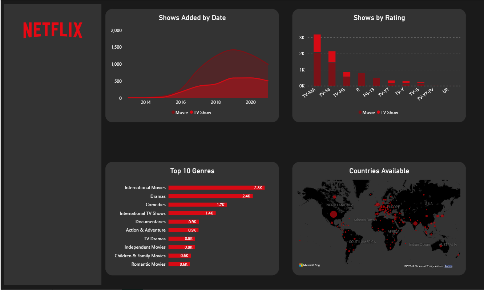
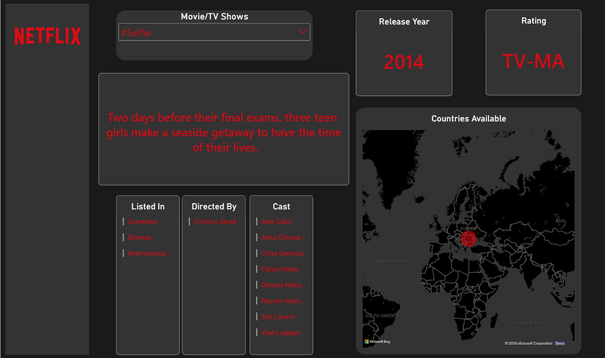

# Netflix Content Analysis Dashboard

An interactive Power BI dashboard exploring Netflix movies and TV shows by release year, rating, genre, and country.

This is a guided learning project completed as part of the Udemy course **[Data Analysis | SQL, Tableau, Power BI & Excel | Real Projects](https://www.udemy.com/course/data-analysis-projects-using-sql-power-bi-tableau-excel/)**.

## Dashboard Preview

### Overview

### Single-title view

## Project Workflow

1. Cleaned the Netflix dataset in Microsoft Excel.
2. Saved the cleaned data as CSV files.
3. Imported the CSV files into MySQL.
4. Connected Power BI to MySQL.
5. Built an interactive dashboard to explore the Netflix titles.

## Dashboard Features

- Explores titles by release year and rating
- Shows the most common genres
- Displays the distribution of titles by country
- Includes a single-title view with details such as cast, director, and description
- Allows users to filter and explore the data interactively

## Tools Used

- **Microsoft Excel** — cleaned the dataset and saved it as CSV files
- **MySQL** — imported and stored the data
- **Microsoft Power BI** — connected to MySQL and created the dashboard

## Dataset

The Netflix titles dataset was downloaded from Kaggle:

[Netflix Movies and TV Shows dataset by Shivam Bansal](https://www.kaggle.com/datasets/shivamb/netflix-shows)

## Repository Contents

- `Netflix Dashboard.pbix` — Power BI report
- `cast.csv`, `country.csv`, `description.csv`, `directors.csv`, `listed_in.csv`, `netflix_titles.csv` — CSV data files
- `images/` — dashboard screenshots

## How to View the Dashboard

1. Download `Netflix Dashboard.pbix`.
2. Open it using Microsoft Power BI Desktop.
3. If prompted, configure the MySQL connection for your environment.

## Learning Credit

This dashboard was created as a guided learning project while following the Udemy course linked above.